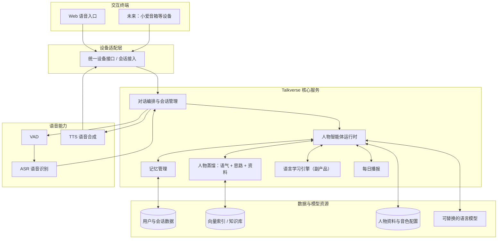

# Talkverse

**An Open World of Conversations**  
**进入一个世界，遇见不同的人。**

Talkverse 是一个开源的 AI 对话世界：在网页上，用户开口和一个**真实名人的"蒸馏版"**对话——用他的语气、他的思路，针对你此刻的处境，给出"换作他会怎么想"的判断。你不再只是读他的访谈、刷他的推特，而是和"他本人"（的 AI 模拟版）说话。

> Learn languages. Meet people. Explore ideas.

---

## 目录

- [为什么做 Talkverse](#为什么做-talkverse)
- [项目愿景](#项目愿景)
- [核心体验](#核心体验)
- [MVP：当前聚焦](#mvp当前聚焦)
- [核心设计](#核心设计)
- [整体技术架构](#整体技术架构)
- [阶段规划](#阶段规划)
- [技术选型方向](#技术选型方向)
- [项目原则](#项目原则)
- [参与项目](#参与项目)
- [项目状态](#项目状态)

---

## 为什么做 Talkverse

我们对那些"厉害的人"天然好奇：马斯克会怎么看这件事、乔布斯会怎么做这个产品、黄仁勋在琢磨什么。现实中我们够不着他们，只能通过访谈、传记、推特去"看"他们——隔着一层。

大语言模型让"把一个人蒸馏成一个可对话的对象"成为可能，但常见的 AI 对话产品往往不够：

- 人物**不像本人**：语气、措辞、思路都是通用模型的复述，聊起来没有沉浸感。
- 记忆有限：难以形成"他越来越懂我"的持续关系。
- 语音体验差：延迟高、不能打断，聊不起来。

Talkverse 想把这些能力组合起来：让用户不是在读一个人的资料，而是**和一个"像到爆表"的名人对话**。

## 项目愿景

### 一个可以和真实名人对话的世界

每个人物都是一个真实名人的 AI 模拟版，由三根支柱构成——**缺一根就塌回"通用 AI"**：

1. **思路** —— 他的价值观棱镜和脑回路。判断"像他"，不只是措辞像他。
2. **语气** —— 他的措辞、节奏、口头禅。沉浸感的来源。
3. **关系** —— 他记得你的处境和偏好，越来越像"你的"马斯克。

用户可以和他讨论他最近在做什么、让他替自己判断眼前的问题，也可以只是打个招呼——**能和一个平时够不着的人说上话，这件事本身就让人上瘾**。

### 以语言为桥梁，而不是把语言变成考试

和名人在**真实英语**里对话，本身就是沉浸式语言环境。英语学习是对话的**副产品**，不是独立的教学功能——我们不做刷题，也不做打断对话的频繁纠错。

## 核心体验

### 1. 和名人对话（像到爆表）

选择一个人物，开口说话。他用自己的语气和思路回应你——从"你最近在忙啥"的日常，到"这件事你会怎么判断"的请教。

```text
你：你最近在忙什么？
马斯克：……（用他的语气讲近况）

你：这个产品方向，换你会怎么砍？
乔布斯：……（用他的思路给判断）

你：Do you remember what we talked about yesterday?
```

### 2. 每日播报（开口钩子）

每天一份"这些名人最近在做什么"的清单，你对哪条感兴趣，就点进去和那个人聊。**把"开口"从"我得想出问题"变成"系统给我递话头"。**

### 3. 英语学习（副产品）

同一个人物可以根据你的水平调整词汇和语速，在对话后给一份简短的复盘——但**不因纠错而失去他自己的风格**。

### 4. 记忆与关系

在获得授权、提供可管理的隐私设置后，人物可以在后续对话里延续之前的话题——越来越像"你的"马斯克。

---

## MVP：当前聚焦

> 详细需求见 [`_bmad-output/planning-artifacts/prds/`](_bmad-output/planning-artifacts/prds/) 下的 PRD。

MVP 只做一件事，并把它做到爆表：**用语音，和一个像到爆表的名人对话。**

- **入口**：网页（浏览器麦克风），桌面 / 手机均可。
- **首批人物**：马斯克（科技/创业）、特朗普（政治）、乔布斯（已故产品家）——覆盖不同领域，同时验证"在世"与"历史"两类人物。
- **质量优先级**：**像本人 > 跟得上热点 > 名人越来越多**。先把少数几个做到"卧槽这也太像了"，再谈数量和热点。

明确不做（v1）：不做英语刷题、不做人物市场/生态、不克隆真人声线、不追"名人越来越多"。

## 核心设计

Talkverse 不打算为每个人物训练独立大模型，而是把通用模型能力与人物配置、知识检索、记忆、语音组合起来，形成可复用的人物运行时。

### Character Agent：人物智能体

人物是核心抽象，由可独立维护和替换的组件构成：

| 组成部分 | 作用 |
| --- | --- |
| Profile | 身份、背景、生平和基本设定 |
| Personality | 性格、价值观、思维倾向和表达风格（**思路**） |
| Voice & Tone | 原创/授权音色，以及语速、措辞等（**语气**） |
| Knowledge | 著作、访谈、演讲、推特等资料及其索引 |
| Memory | 与用户之间的对话记忆（**关系**） |
| Sources | 资料来源、授权信息、可信度与时间 |

### Learning Engine：语言学习引擎

作为副产品的语言能力：理解用户水平、控制难度、给反馈——但不把所有人物都变成同一种英语老师。

### Memory Engine：记忆引擎

区分会话上下文、跨会话记忆和人物知识资料，提供查看/修改/删除等管理能力。

### Voice Engine：语音引擎

VAD → ASR → LLM → TTS 的实时链路，关注流式、低延迟、打断和连续对话。

### Device Adapter：设备适配层

网页是首个入口；未来通过适配层接入小爱音箱等设备，核心对话系统不与具体硬件耦合。

## 整体技术架构



### 关键架构原则

1. **人物与模型解耦**：人物设定不绑定模型供应商。
2. **核心与设备解耦**：网页、小爱等共用核心，通过适配器接入。
3. **学习与人格解耦**：语言难度可调，但不覆盖人物个性。
4. **知识与记忆分离**：人物公开资料、用户个人记忆、会话上下文有不同用途与权限。
5. **能力模块化**：ASR、TTS、模型、向量库等都可替换。

## 阶段规划

小步迭代，先验证核心体验，再扩展人物和终端。

### Phase 0：产品定义与技术验证

- [x] 收敛 MVP 核心体验与范围（PRD 已产出）。
- [ ] 确定首批 3 个人物的蒸馏数据源（访谈/演讲/推特/书）。
- [ ] 跑通 ASR → LLM → TTS 的最小语音对话链路，验证延迟与打断。
- [ ] 选定"像本人"的蒸馏方案与原创/授权音色方案。

### Phase 1：最小可用原型（MVP）

- [ ] 提供 Web 语音对话入口。
- [ ] 上线首批 3 个人物（马斯克 / 特朗普 / 乔布斯），做到"像到爆表"。
- [ ] 每日播报（可先人工/静态内容）。
- [ ] 英语学习作为副产品（难度自适应 + 对话后复盘）。
- [ ] 基础记忆 / 关系（可后置）。

### Phase 2：沉浸式体验增强

- [ ] 跟热点（web search 让"你最近在忙啥"新鲜）。
- [ ] 主动推送话头。
- [ ] 优化流式语音、打断和延迟。
- [ ] 更多名人，逐步铺开。

### Phase 3：开放人物生态

- [ ] 发布 Character Package 人物包规范。
- [ ] 支持社区创建、分享、维护人物包。
- [ ] 更多语言及多语言场景。

### Phase 4：多终端与硬件探索

- [ ] 小爱音箱等设备的接入。
- [ ] 评估独立硬件的产品形态。
- [ ] 端云协同、离线能力与隐私方案。

> 以上是方向性规划，不代表功能已实现，也不构成交付承诺。

## 技术选型方向

初期优先成熟、可替换、便于本地运行的组件；以真实原型测试为准。

| 层次 | 候选技术或方案 | 说明 |
| --- | --- | --- |
| 后端服务 | Python、FastAPI | API 服务与业务编排 |
| Web 前端 | Vue 3、TypeScript | 网页语音入口 |
| 对话模型 | 可替换的云端或本地 LLM | 人物对话与语言反馈 |
| 语音识别 | faster-whisper 等 | 语音转文本 |
| 语音合成 | Qwen3-TTS、CosyVoice、GPT-SoVITS 等 | 语音生成与流式输出 |
| 人物蒸馏 | 参考 SillyTavern 人物卡、开源 persona 蒸馏项目 | 语气 + 思路的提炼 |
| 实时语音 | LiveKit / Pipecat 等（参考） | 低延迟 + 打断 |
| 知识检索 | RAG、向量索引 | 人物资料检索与引用 |
| 数据存储 | PostgreSQL 等 | 用户、人物配置与会话数据 |

## 项目原则

### 1. 真实与模拟必须清晰区分

人物是 AI 构建的模拟角色，不是本人。在世人物近期动态仅依据可核实公开资料；历史人物为假设性讨论；真实资料、合理推断与虚构模拟三者分清，不冒充本人、不编造私生活。

### 2. 尊重声音、形象和资料权利

优先使用原创内容、开放授权资料或取得明确授权的资源。**不得将未经授权的真人声音克隆作为默认功能**——"像"靠语气、措辞和思路，不靠克隆声线。

### 3. 用户拥有记忆控制权

用户知道系统保存了哪些个人记忆，并可查看、修改、删除。

### 4. 学习体验优先于纠错数量

语言纠错服务于交流，不打断交流。

### 5. 像本人，优先于铺量

先把少数人物做到"像到爆表"，再谈热点和数量。

### 6. 开放、模块化、可替换

人物、模型、知识库、语音和适配器都用明确接口，社区可独立扩展某个模块。

## 参与项目

欢迎对以下方向感兴趣的开发者和贡献者参与：

- AI Agent、LLM 应用与对话编排。
- 人物蒸馏、RAG 与长期记忆。
- ASR、TTS、实时语音交互（低延迟、打断）。
- 英语学习 / 语言习得反馈设计。
- Web 前端、后端服务与部署。
- 人物资料规范、来源核验与内容治理。

## 项目状态

<details>
<summary>当前状态：构想与方案设计阶段（PRD 已产出）</summary>

Talkverse 目前处于产品定义与技术方案探索阶段。MVP 范围已在 PRD 中收敛。

当前优先事项：

1. 确定首批 3 个人物的蒸馏数据源与音色方案。
2. 跑通最小语音对话链路（延迟、打断）。
3. 实现 Web 语音入口与首批人物。

</details>

---

## 名称与品牌

**Talkverse** = Talk + Universe

- **Project Name**：Talkverse
- **Tagline**：An Open World of Conversations
- **中文表达**：进入一个世界，遇见不同的人。
- **核心理念**：Learn languages. Meet people. Explore ideas.

---

*Talkverse — An Open World of Conversations.*
